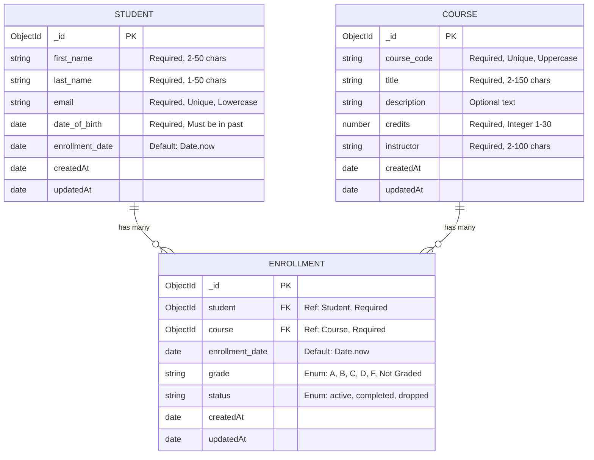

# Student Record Management REST API

A production-ready backend application built with **Express.js (Node.js)** and **MongoDB / Mongoose** designed to manage student records, course catalog, and student enrollments with relational data modeling, thorough validations, pagination, filtering, search, and sorting.

---

## 📋 Features

- **Relational Data Modeling:** Relational junction between `Student` and `Course` via `Enrollment` model with compound unique indexing (prevents duplicate enrollments) and cascading deletions.
- **Full CRUD Support:** Complete Create, Read, Update, and Delete endpoints for Students, Courses, and Enrollments.
- **Input Validation & Sanitization:** Multi-layer request validation via `express-validator` and Mongoose schema constraints (email formats, past birth dates, allowed grade and status enums, positive credits, etc.).
- **Query Capabilities:**
  - **Search:** Case-insensitive search across first name, last name, and email for students; code, title, and instructor for courses.
  - **Filtering:** Exact and range filtering (e.g. course credits, instructor, enrollment status, grades).
  - **Sorting:** Multi-field ascending and descending sorting (e.g., `sort=-createdAt`, `sort=first_name`).
  - **Pagination:** Structured metadata (`total`, `page`, `limit`, `totalPages`, `hasNextPage`, `hasPrevPage`).
- **Robust Error Handling:** Centralized error handler returning standardized JSON with precise HTTP status codes (`200`, `201`, `400`, `404`, `409`, `500`).
- **Comprehensive Test Suite:** Automated test suite testing all endpoints, relationships, validations, and edge cases.
- **Mock Data Seeder:** Instant seeding script populated with sample students, university courses, and enrollments.

---

## 🏛️ Database Schema & Relationships



> **Unique Compound Constraint:** Each `(student, course)` pair in `Enrollment` is uniquely indexed to enforce that a student cannot be enrolled in the same course more than once.

---

## 🚀 Quick Start

### 1. Prerequisites
- **Node.js** (v18.x or later)
- **MongoDB** running locally on port `27017` (e.g. `mongodb://127.0.0.1:27017/student_records`)

### 2. Installation
From the root folder:
```bash
npm install --prefix server
```

### 3. Seed Sample Data
Populate the database with demo students, courses, and enrollments:
```bash
npm run seed
```

### 4. Run Automated Test Suite
Run the 24-step integration test suite:
```bash
npm test
```

### 5. Start the Server
```bash
npm start
```
The server will start at:
- **Base URL:** `http://localhost:5000`
- **Health Check:** `http://localhost:5000/api/health`
- **API Overview:** `http://localhost:5000/`

---

## 📡 REST API Reference

### 1. Health & Meta
| Method | Endpoint | Description |
|---|---|---|
| `GET` | `/` | API description and route documentation |
| `GET` | `/api/health` | Check API uptime and MongoDB connection state |

---

### 2. Students API (`/api/students`)

| Method | Endpoint | Description |
|---|---|---|
| `POST` | `/api/students` | Register a new student |
| `GET` | `/api/students` | List students with search, sort, and pagination |
| `GET` | `/api/students/:id` | Get student by ID with populated enrollments |
| `PUT` | `/api/students/:id` | Update student details |
| `DELETE` | `/api/students/:id` | Delete student and cascade delete enrollments |

#### Query Parameters for `GET /api/students`:
- `search`: Filter by student first name, last name, or email (e.g. `?search=alice`)
- `sort`: Sort field. Prepend `-` for descending (e.g. `?sort=-enrollment_date`, `?sort=first_name`)
- `page`: Page number (default: `1`)
- `limit`: Items per page (default: `10`, max: `100`)

#### Create Student Example (`POST /api/students`):
```json
// Request Body
{
  "first_name": "Eleanor",
  "last_name": "Rigby",
  "email": "eleanor.rigby@university.edu",
  "date_of_birth": "2003-07-21"
}
```

```json
// Response (201 Created)
{
  "success": true,
  "message": "Student created successfully",
  "data": {
    "_id": "660c1d2e...",
    "first_name": "Eleanor",
    "last_name": "Rigby",
    "email": "eleanor.rigby@university.edu",
    "date_of_birth": "2003-07-21T00:00:00.000Z",
    "enrollment_date": "2026-10-13T13:50:00.000Z",
    "createdAt": "2026-10-13T13:50:00.000Z",
    "updatedAt": "2026-10-13T13:50:00.000Z"
  }
}
```

---

### 3. Courses API (`/api/courses`)

| Method | Endpoint | Description |
|---|---|---|
| `POST` | `/api/courses` | Create a new course |
| `GET` | `/api/courses` | List courses with search, filters, sort, and pagination |
| `GET` | `/api/courses/:id` | Get course by ID with enrolled students |
| `PUT` | `/api/courses/:id` | Update course details |
| `DELETE` | `/api/courses/:id` | Delete course and cascade delete enrollments |

#### Query Parameters for `GET /api/courses`:
- `search`: Search code, title, or instructor (e.g. `?search=computer`)
- `credits`: Filter by credit count (e.g. `?credits=4`)
- `instructor`: Filter by instructor name (e.g. `?instructor=Turing`)
- `sort`: `course_code`, `title`, `credits`, `instructor`, `-createdAt`
- `page`: Page number (default: `1`)
- `limit`: Items per page (default: `10`)

#### Create Course Example (`POST /api/courses`):
```json
// Request Body
{
  "course_code": "CS305",
  "title": "Cloud Computing and Distributed Systems",
  "description": "Design and deployment of scalable distributed architectures.",
  "credits": 4,
  "instructor": "Dr. Werner Vogels"
}
```

---

### 4. Enrollments API (`/api/enrollments`)

| Method | Endpoint | Description |
|---|---|---|
| `POST` | `/api/enrollments` | Enroll student into a course |
| `GET` | `/api/enrollments` | List enrollments with filters & populated relations |
| `GET` | `/api/enrollments/:id` | Get single enrollment by ID |
| `PUT` | `/api/enrollments/:id` | Update enrollment grade or status |
| `DELETE` | `/api/enrollments/:id` | Drop / delete an enrollment record |

#### Query Parameters for `GET /api/enrollments`:
- `student`: Filter by student ObjectId (e.g. `?student=660c1d2e...`)
- `course`: Filter by course ObjectId (e.g. `?course=660c1f5a...`)
- `status`: `active`, `completed`, or `dropped`
- `grade`: `A`, `B`, `C`, `D`, `F`, or `Not Graded`
- `sort`: `enrollment_date`, `grade`, `status`, `-createdAt`
- `page` & `limit`: Pagination parameters

#### Create Enrollment Example (`POST /api/enrollments`):
```json
// Request Body
{
  "student": "660c1d2e1a2b3c4d5e6f7a8b",
  "course": "660c1f5a1a2b3c4d5e6f7a8c",
  "grade": "Not Graded",
  "status": "active"
}
```

#### Update Enrollment Example (`PUT /api/enrollments/:id`):
```json
// Request Body
{
  "grade": "A",
  "status": "completed"
}
```

---

## 🔒 Validation & Error Response Structure

All validation failures and application errors follow a unified JSON response:

```json
// Example 400 Validation Error
{
  "success": false,
  "message": "Validation failed",
  "errors": [
    {
      "field": "date_of_birth",
      "message": "Date of birth must be in the past",
      "value": "2099-01-01"
    }
  ]
}
```

```json
// Example 409 Conflict Error (Duplicate student/course or duplicate email)
{
  "success": false,
  "message": "Student is already enrolled in this course"
}
```

---

## 📁 Project Structure

```
├── server/
│   ├── config/
│   │   └── db.js                 # MongoDB connection logic
│   ├── controllers/
│   │   ├── studentController.js  # Student business logic & queries
│   │   ├── courseController.js   # Course business logic & queries
│   │   └── enrollmentController.js# Enrollment logic & relation joins
│   ├── middleware/
│   │   ├── errorHandler.js       # Centralized 404 & error middleware
│   │   └── validate.js           # Express-validator results middleware
│   ├── models/
│   │   ├── Student.js            # Student Mongoose schema & indexes
│   │   ├── Course.js             # Course Mongoose schema & indexes
│   │   └── Enrollment.js         # Relational junction schema & compound index
│   ├── routes/
│   │   ├── studentRoutes.js      # Student endpoint router
│   │   ├── courseRoutes.js       # Course endpoint router
│   │   └── enrollmentRoutes.js   # Enrollment endpoint router
│   ├── utils/
│   │   ├── apiError.js           # Custom operational error class
│   │   ├── asyncHandler.js       # Async exception wrapper
│   │   └── queryFeatures.js      # Pagination, sorting, search helpers
│   ├── validators/
│   │   ├── studentValidator.js   # Input validation rules for students
│   │   ├── courseValidator.js    # Input validation rules for courses
│   │   └── enrollmentValidator.js# Input validation rules for enrollments
│   ├── .env                      # Environment configurations
│   ├── package.json              # Server dependencies and scripts
│   ├── seed.js                   # Database seeding script
│   ├── server.js                 # Express application entrypoint
│   └── test-api.js               # 24-step integration test runner
├── package.json                  # Root runner script
└── README.md                     # Project documentation
```
